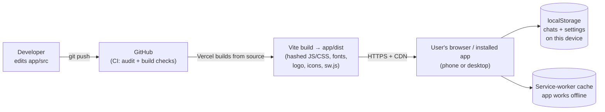
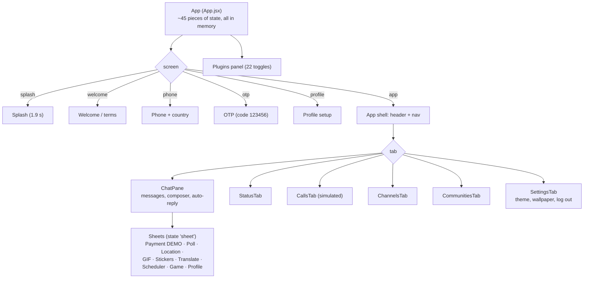
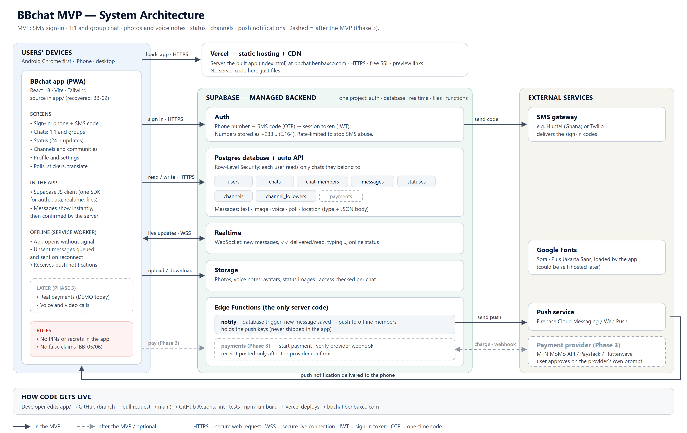
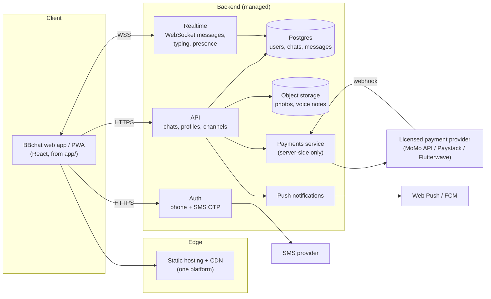
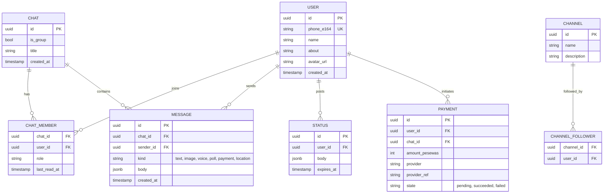
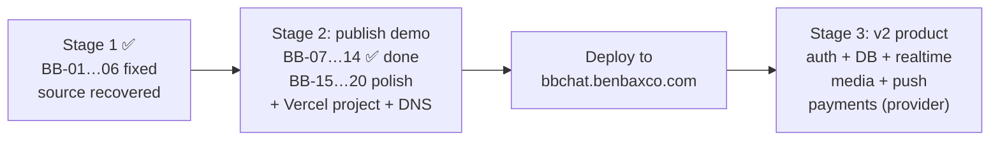

# BBchat — System Design

Status: 19 November 2026 · Branch `review/bb-fixes` · Covers the system today (v1.2 demo) and the target system (v2 product).

---

## 1. What we intend to achieve

**BBchat** is BENBAX's own messaging app for the Katamanso / Apolonia / Tema community: chat, status, calls, channels and communities, plus local add-ons such as mobile-money payments, polls, translation into Twi and Ga, and a business catalogue.

The site was handed over as a **front-end-only prototype** with no source code and no documentation. The work runs in three stages:

| Stage | Goal | Done when |
|---|---|---|
| **1. Honest, working demo** *(done, not deployed)* | Fix what was broken or misleading (`BB-01` to `BB-06`), recover editable source, document everything | All six fixes verified, source in `app/`, proof report delivered |
| **2. Demo ready to publish** *(BB-07 to BB-14 done; BB-15 to BB-20 and go-live next)* | One hosting platform, a clean repo, no fake numbers, correct page metadata, chats saved on the device, installable on phones | `BB-07` to `BB-20` closed; live on `bbchat.benbaxco.com` |
| **3. Real product (v2)** | Real accounts with SMS sign-in, real-time messages between people, media, notifications, real payments through a licensed provider | People in Tema can sign up and chat with each other for real |

**Guiding rules:** never claim a feature the system doesn't have (encryption, payments, servers); keep one source of truth (`app/`); and make every change verifiable (git history plus before/after proof).

---

## 2. The system today (v1.2 demo)

### 2.1 Overview



* **No backend, no database, no API.** The whole app runs inside the browser.
* **Data stays on the device:** after sign-in, chats and settings are saved in `localStorage` and cleared on log out (BB-07).
* **No third-party requests:** fonts are bundled with the app (BB-13).
* **Installable and offline-capable** through the manifest and service worker (BB-08).

### 2.2 Repository layout

```
BBchat/
├── app/                        ← SOURCE (edit here)
│   ├── src/
│   │   ├── main.jsx            entry: fonts, <App/> (remounted on log out), service worker
│   │   ├── App.jsx             all screens + state (~2,300 lines)
│   │   ├── storage.js          save / load / clear on the device (BB-07)
│   │   ├── data.js             seed chats, countries, replies, emojis, translations
│   │   ├── icons.jsx           35 Lucide icons
│   │   ├── index.css           Tailwind + theme variables + animations
│   │   └── assets/             logo 288 px WebP + 64 px PNG (+ 500 px master)
│   ├── public/                 manifest.webmanifest, sw.js, icons/, favicon.ico, og-image.png
│   ├── index.html              title, description, sharing tags, manifest link
│   ├── vite.config.js          normal multi-file build → app/dist
│   └── package.json            React 18.3.1, Vite 6.4.6, Tailwind 3.4.17, @fontsource-variable
├── vercel.json                 the only host: builds app/, publishes app/dist only
├── .github/workflows/ci.yml    checks on every push (no deploy)
├── docs/, proof/               diagrams; management proof reports (never published)
└── README.md, ISSUES.md, SYSTEM-DESIGN.md
```

### 2.3 Inside the app



| Concern | How it works today |
|---|---|
| **Sign-in** | Fixed demo OTP `123456`. No SMS is sent and no account is created. |
| **Messaging** | `sendMessage()` adds the message to the in-memory chat list. After 1.4 s, one of 5 canned replies arrives. |
| **Payments** | Form with PIN `1234` that produces a **DEMO** receipt. No money moves (BB-06). |
| **Theme** | CSS variables in `index.css`. `.dark` / `.light` on `<html>` override the device setting (BB-04). |
| **Inner tabs** | Called as functions (`ChatPane({})`), not as `<ChatPane/>`, so inputs keep focus (BB-01). |
| **Persistence** | `storage.js` saves the signed-in state to `localStorage` after every change; log out clears it and remounts the app (BB-07). |
| **Offline / install** | `manifest.webmanifest` + `sw.js`: app shell and hashed files cached; pages network-first (BB-08). |

### 2.4 Build and release

| Step | Command | Result |
|---|---|---|
| Develop | `npm run dev` (in `app/`) | Live-reload server at `localhost:5173` |
| Check | push to GitHub | CI: `npm ci`, `npm audit --omit=dev`, `npm run build`, output checks |
| Deploy | merge to `main` | Vercel runs `npm run build --prefix app` and serves `app/dist` |

Verification used so far:
- headless-Edge screen captures compared pixel by pixel across 12 screens;
- Chrome's installability check (0 errors) and an offline reload;
- slow-4G cold-load timing (first screen 0.83 s, 144 KB);
- `npm audit` (0 vulnerabilities).

---

## 3. Target system (v2 product)

### 3.1 Overview



*Editable source: [docs/architecture-mvp.svg](docs/architecture-mvp.svg).*



**Recommended approach:** use a **managed backend** (Supabase or Firebase) for auth, database, realtime and storage, so a small team can ship without running servers. Only the **payments service** needs custom server code (an edge or serverless function), because it holds provider secrets and must verify every transaction.

### 3.2 Core data model



The demo's message shape (`{ id, from, text, kind, time, poll?, amount?, method? }`) maps directly to `MESSAGE.kind` plus `body`, so the UI can move over with little change.

### 3.3 Key flows

**Sign-in (replaces the fixed `123456`):** the phone number is normalised to E.164 (`+233…` without the leading 0) → the auth service sends an SMS OTP → the user enters it (with SMS autofill: `BB-17`) → a session token is stored securely → the profile is created on first login.

**Send a message:** the client shows the message instantly as "sending" → the API inserts it → realtime broadcasts it to the chat members → a ✓✓ tick shows delivery → members who are offline get a push notification.

**Payment (real, later):** the client asks the payments service to start a payment → the service calls the provider (**the PIN is entered on the provider's own prompt, never in BBchat**) → the provider calls back a webhook → the service verifies it and marks the payment `succeeded` → only then is a receipt message posted. No receipt is ever created on the client.

### 3.4 Security and compliance

| Area | Requirement |
|---|---|
| Transport | HTTPS / WSS only; HSTS on the domain |
| Access control | Row-level security: users read only chats they belong to |
| Secrets | Provider keys only in server functions, never in the client bundle |
| Claims | No "end-to-end encrypted" label unless E2EE is actually built (e.g. Signal protocol); state what really happens (BB-05) |
| Payments | Licensed provider only; server-side verification; no PINs collected by the app (BB-06) |
| Data protection | Ghana Data Protection Act 2012 (register with the Data Protection Commission); privacy policy; consent before analytics (BB-15) |
| Brand | Original name and look, no third-party trademarks (BB-03) |
| Abuse | Rate-limit OTP and messages; block and report users |

### 3.5 Non-functional targets

| Target | Value |
|---|---|
| First load on 4G phones | < 3 s; JS + CSS < 200 KB gzip (BB-13) |
| Message delivery (online) | < 1 s end to end |
| Availability | 99.5 % (managed services) |
| Offline | App shell loads offline; queued messages send on reconnect (BB-08) |
| Devices | Android Chrome first (most of the Ghana market), then iOS Safari and desktop |

---

## 4. Roadmap



| Stage | Main items | Rough effort |
|---|---|---|
| 2: publish the demo | BB-07, BB-08, BB-09, BB-10, BB-11, BB-12, BB-13, BB-15, BB-16, BB-17 | 3–5 days |
| 2.5: code health | Split `App.jsx` into screen files, ESLint, Playwright smoke tests in CI (BB-20) | 2–3 days |
| 3: v2 MVP | Auth, chats and messages with realtime, profiles, push | 3–5 weeks |
| 3+: payments | Provider onboarding, payments service, webhook verification | 2–4 weeks + provider approval time |

---

## 5. Decisions needed from BENBAX

| # | Decision | Options | Recommendation |
|---|---|---|---|
| 1 | Hosting platform | Vercel · Netlify · GitHub Pages · cPanel | **Vercel** (config already present, free SSL, previews) |
| 2 | Brand colours | Keep the WhatsApp-like green · Move to BENBAX navy `#0a1931` / gold `#f2b705` | Move to BENBAX colours (distinct brand) |
| 3 | Dashboard page | Delete · Keep behind login with real data | Delete until real data exists |
| 4 | Backend for v2 | Supabase · Firebase · Custom server | **Supabase** (Postgres, realtime, auth with SMS; easy to export data) |
| 5 | Payment provider | MTN MoMo API · Paystack · Flutterwave | Decide after a business and licensing check |
| 6 | Encryption claim | Build real E2EE · Never claim it | Don't claim it in v2; consider E2EE later |
